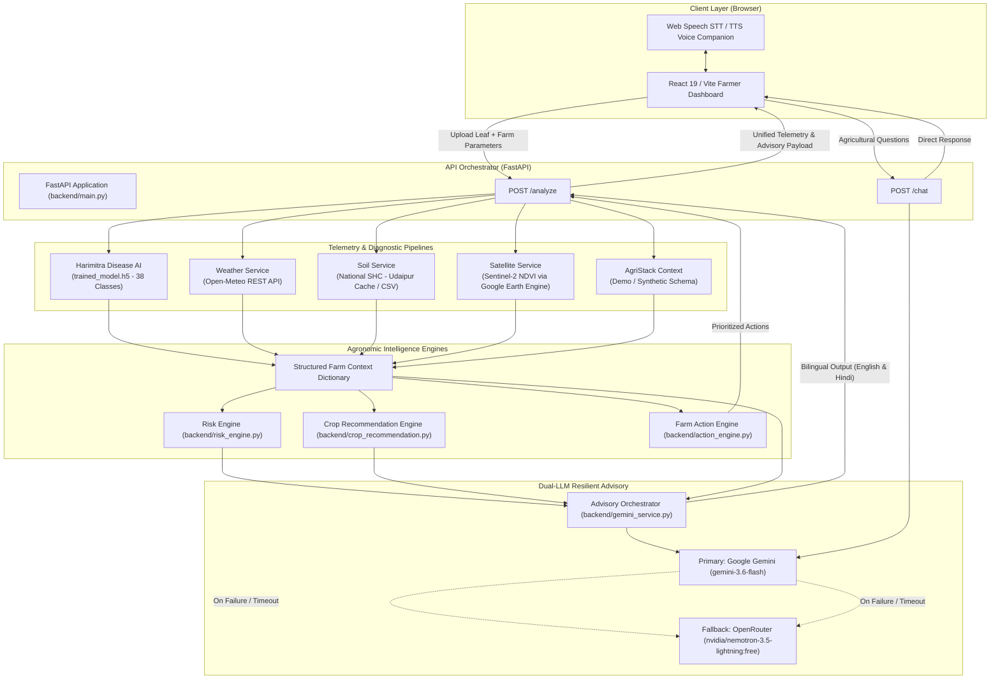

# KrashiMitra — AI-Powered Agricultural Intelligence Platform

> A multi-modal agronomic intelligence and diagnostic system for Indian farmers, fusing crop pathology computer vision, in-situ Soil Health Card telemetry, real-time meteorological forecasting, and Sentinel-2 satellite observation into grounded, actionable, bilingual advisory.

---

## 1. Project Title & Overview

**KrashiMitra** is an AI-powered agricultural intelligence platform developed as a prototype for the **BUILD 2036** submission (and associated with Google Cloud community AI initiatives). Designed to provide smallholder farmers with holistic, data-grounded farm advisories, KrashiMitra unifies five critical layers of agricultural intelligence:

1. **Leaf Pathology Computer Vision:** Deep learning diagnosis across 38 crop condition classes using the Harimitra AI convolutional neural network.
2. **In-Situ Soil Health Records:** 12-parameter soil fertility benchmarking based on the Government of India National Soil Health Card (SHC) scheme.
3. **Hyperlocal Meteorological Forecasts:** Real-time ambient temperature, relative humidity, and 7-day precipitation probability via Open-Meteo.
4. **Earth Observation Remote Sensing:** Multispectral vegetation health indexing (Sentinel-2 NDVI) via Google Earth Engine with automated fallback.
5. **Priority-Ranked Field Actions:** Grounded, non-hallucinatory action directives categorized by urgency, timeframe, and explicit telemetry evidence.

These signals feed into a deterministic agronomic logic engine and a strictly guarded dual-LLM advisory pipeline (Google Gemini primary with automated OpenRouter fallback), delivering twin advisories in natural Devanagari Hindi and English through a responsive web dashboard with browser-native voice assistance and permission-based current location detection alongside manual coordinate entry.

---

## 2. Problem Statement

Indian agriculture sustains over 150 million farming households, yet smallholder farmers face compounding diagnostic and operational hurdles:

* **Fragmented & Isolated Diagnostics:** Farmers often rely on visual inspection or single-purpose photo apps that detect leaf spots in a vacuum, ignoring critical soil chemistry, moisture stress, and microclimate conditions.
* **Over-Fertilization & Soil Degradation:** Chemical fertilizers are frequently applied without reference to Soil Health Card data, depleting soil organic carbon, disturbing microbial biology, and inflating input costs.
* **Weather & Chemical Runoff Volatility:** Unanticipated precipitation within hours of spraying washes away costly fungicides and insecticides, leading to chemical runoff and wasted expenditure.
* **Language & Digital Literacy Barriers:** Complex technical extension advisories are rarely available in simple, vernacular language with hands-free voice assistance.
* **Generative AI Hallucination Hazards:** Generic LLMs without strict agricultural grounding can invent unverified pesticide dosages or chemical spray windows, creating severe financial and biological hazards for farmers.

---

## 3. Our Solution

KrashiMitra addresses these challenges through a unified **multi-modal farm context** pipeline:

* **Holistic Multi-Modal Diagnosis:** Integrates leaf pathology detection with in-situ soil measurements, ambient weather telemetry, and satellite vegetation indices.
* **Deterministic Agronomic Logic:** Crop suitability rankings, risk levels, and field action directives are computed using rule-based algorithms with transparent rationales and data-completeness scoring, rather than unconstrained generative guesses.
* **Strictly Grounded Bilingual LLM Advisory:** A resilient dual-LLM pipeline (Google Gemini 3.6 Flash primary, OpenRouter free-tier fallback) operates under strict system prompts: it generates twin advisories in English and natural Devanagari Hindi, refuses to prescribe unverified chemical dosages, flags missing data parameters, and avoids awkward literal translations.
* **Inclusive Voice-First UI:** Built-in browser-native Speech-to-Text (STT) and Text-to-Speech (TTS) allow farmers to speak queries and listen to advice in their preferred language.

---

## 4. Key Implemented Features

| Feature | Category | Implementation Status | Description |
| :--- | :--- | :--- | :--- |
| **Harimitra Disease AI** | Computer Vision | **Implemented** | 38-class crop condition classification using a Keras deep learning model (`trained_model.h5`, 128×128 input). |
| **12-Parameter Soil Health Card** | Soil Intelligence | **Implemented (Udaipur Demo)** | Evaluates Primary Macronutrients (NPK), Micronutrients (S, Zn, Fe, Cu, Mn, B), and Physical-Chemical indices (pH, EC, Organic Carbon) against official benchmarks. |
| **Hyperlocal Weather Telemetry** | Meteorology | **Implemented** | Fetches live ambient temperature, relative humidity, and 7-day precipitation probabilities from Open-Meteo with graceful error shielding. |
| **Sentinel-2 Satellite NDVI** | Remote Sensing | **Implemented (GEE-backed)** | Computes mean, median, min, and max Normalized Difference Vegetation Index (NDVI) within a 500m farm buffer via Google Earth Engine. |
| **Priority Field Action Engine** | Agronomic Decisioning | **Implemented** | Generates prioritized, non-hallucinatory field actions (pathology verification, rainfast precautions, in-situ moisture checks) with explicit evidence and data sources. |
| **Automated Irrigation Guidance** | Agronomic Rules | **Implemented** | Rule-based soil moisture evaluation generating calibrated irrigation status (Required, Not Required, High Moisture). |
| **Alternative Crop Engine** | Agronomic Rules | **Implemented** | Deterministic ranking of 6 crops (Wheat, Rice, Maize, Mustard, Chickpea, Cotton) based on soil pH, moisture, rainfall tolerance, and NPK requirements. |
| **Multi-Factor Risk Engine** | Risk Assessment | **Implemented** | Computes composite farm risk (`HIGH`, `MEDIUM`, `LOW`) across disease confidence, moisture thresholds, and weather forecasts (with proper low-risk classification for healthy leaves). |
| **Bilingual AI Advisory** | Generative AI | **Implemented** | Structured 4-part advisory (Main Risk, Why Risk Matters, What to Do Now, More Information Needed) in English and natural Devanagari Hindi using Gemini with OpenRouter fallback. |
| **Prompt Injection Defense** | Security | **Implemented** | Delimiter-based input encapsulation (`<farmer_message>`), tag sanitization, and strict system boundary enforcement for farmer chat. |
| **Bilingual Voice Companion** | Accessibility | **Implemented (Web Speech API)** | Browser-native speech recognition (STT) and speech synthesis (TTS) supporting `hi-IN` and `en-IN` without external audio API costs. |
| **Current Location Detection** | Frontend UX | **Implemented (Browser Geolocation API)** | Permission-based **"Use My Current Location"** button (`मेरा वर्तमान स्थान उपयोग करें`) that retrieves browser coordinates and fills latitude and longitude automatically with loading, confirmation, and error states, while keeping manual coordinate entry available. |
| **AgriStack Context Card** | Public Digital Infra | **Mock / Demo Schema** | Synthesized farmer and plot profile (`KM-FARMER-001`, 2.5 acres, Tomato) demonstrating schema interoperability with Digital Public Infrastructure (DPI). |

---

## 5. System Architecture



*Client-Side Coordinate Input Note:* On the browser client, the optional **"Use My Current Location"** control uses the Browser Geolocation API to populate the latitude and longitude inputs prior to submission. This operates solely in the browser and does not modify the FastAPI backend API or frozen system architecture.

---

## 6. How the Analysis Workflow Works

Before submitting an analysis request, the farmer can optionally click **"Use My Current Location"** to populate latitude and longitude via the Browser Geolocation API (subject to browser permission) or enter coordinates manually (blank inputs default to `24.5854`, `73.7125` in `src/App.jsx`). When a farmer submits a leaf image and farm parameters via `POST /analyze`:

```
1. Image Buffering ──► Uploaded file saved temporarily with a unique UUID prefix
2. Disease Detection ──► Harimitra Keras CNN predicts pathology & confidence (128x128 input)
3. Irrigation Rule ──► Evaluates soil moisture threshold (<40% Required, 40-70% Not Required, >70% High)
4. Weather Telemetry ──► Queries Open-Meteo for temperature, humidity, and 7-day rain probability
5. Satellite NDVI ──► Queries Sentinel-2 L2A collection (<30% cloud cover) via Earth Engine
6. Soil Health Lookup ──► Loads 12 SHC parameters from Udaipur benchmark cache / dataset
7. Crop Recommendation ──► Scores 6 alternative crops against soil pH, moisture, rainfall & NPK
8. Risk Calculation ──► Determines individual and overall risk (Disease, Water, Weather)
9. Priority Farm Actions ──► Evaluates verified telemetry to produce prioritized, grounded field actions
10. Farm Context Synthesis ──► Aggregates all telemetry into a structured, unified dictionary
11. Grounded LLM Advisory ──► Gemini 3.6 Flash generates synchronized English & Hindi advisories
12. Resilient Fallback ──► If Gemini fails or times out, OpenRouter automatically fulfills the request
13. Dashboard Rendering ──► Response returned to client; temporary upload buffer cleaned up
```

---

## 7. Technology Stack

### Frontend
* **Framework:** React 19.2.8 with Vite 8.2.2
* **Styling:** Modular Pure CSS3 (`App.css`, `index.css`) — Zero third-party UI framework overhead
* **Graphics & Icons:** 14 standalone SVG functional components (zero external icon library bloat)
* **Voice Engine:** Web Speech API (`SpeechRecognition` / `webkitSpeechRecognition` and `SpeechSynthesis`)
* **Location Input:** Browser Geolocation API (`navigator.geolocation.getCurrentPosition`) for permission-based current coordinate detection with manual input fallback
* **Localization:** Centralized `UI_STRINGS` dictionary supporting English and natural farmer-friendly Hindi/Hinglish

### Backend & API
* **Application Framework:** FastAPI 0.141.1 on Python 3.10
* **ASGI Server:** Uvicorn 0.52.4
* **Concurrency:** Offloaded synchronous CPU tasks via Starlette `run_in_threadpool`
* **Data Validation:** Pydantic 2.13.5
* **Multipart Handling:** `python-multipart` 0.0.32
* **HTTP Client:** `requests` 2.34.2

### Machine Learning & Computer Vision
* **Deep Learning Framework:** TensorFlow 2.15.0 / Keras
* **Disease Model:** Harimitra CNN (`trained_model.h5`, 94.2 MB)
* **Image Processing:** Pillow 12.3.0, NumPy 1.23.5

### Cloud, Geospatial & LLM Integrations
* **Generative AI Primary:** Google GenAI SDK (`gemini-3.6-flash`)
* **Generative AI Fallback:** OpenRouter API (`nvidia/nemotron-3.5-lightning:free`)
* **Earth Observation:** Google Earth Engine (`earthengine-api` — Sentinel-2 Harmonized SR)
* **Meteorology:** Open-Meteo REST API (open-access meteorological forecasts)

### Infrastructure & Deployment
* **Containerization:** Docker (multi-stage builds for frontend and backend)
* **Cloud Platform:** Google Cloud Run (`asia-south1` region), Google Cloud Build

---

## 8. Verified Deployment URLs

The prototype has been deployed and verified on Google Cloud Run:

* **Live Frontend Dashboard:**
  [https://krashimitra-frontend-694455455896.asia-south1.run.app](https://krashimitra-frontend-694455455896.asia-south1.run.app)

* **Live Backend Service:**
  [https://krashimitra-backend-694455455896.asia-south1.run.app](https://krashimitra-backend-694455455896.asia-south1.run.app)

* **Backend Health Check:**
  [https://krashimitra-backend-694455455896.asia-south1.run.app/](https://krashimitra-backend-694455455896.asia-south1.run.app/)

---

## 9. Dashboard Preview & Screenshots

The user interface is designed for low-cognitive-load farmer interaction, pairing clear visual status indicators with bilingual text and voice controls:

| Section | Description | Visual Reference |
| :--- | :--- | :--- |
| **Diagnostics & Telemetry Input** | Drag-and-drop leaf photo uploader, image preview panel, permission-based **"Use My Current Location"** button (Browser Geolocation API), and manual farm telemetry inputs (soil moisture, latitude, longitude) with default Udaipur anchor. | *Dropzone & Telemetry Input Panel* |
| **Unified Diagnostics Overview** | Real-time telemetry summary displaying detected disease condition, overall farm risk, soil moisture, irrigation advice, ambient weather, rain forecast, and Sentinel-2 NDVI. | *Telemetry Overview Cards* |
| **Priority-Ranked Field Actions** | Structured, evidence-backed action directives (e.g. Next Field Visit, Before Application) with action steps, rationale, and verified data provenance. | *Field Actions Panel* |
| **Bilingual AI Advisory** | Four-part structured agronomic guidance (Main Risk, Why Risk Matters, What to Do Now, More Information Needed) presented in natural Devanagari Hindi or English. | *AI Agricultural Advisory Card* |
| **Alternative Crop Recommendations** | Ranked shortlist of alternative crops (e.g. Mustard, Wheat, Chickpea) with suitability badges, numeric match score (0–100), and agronomic moisture rationale. | *Crop Recommendation Grid* |
| **12-Parameter Soil Health Card** | Soil Health Card grid categorizing Primary Macronutrients (NPK), Micronutrients (S, Zn, Fe, Cu, Mn, B), and Physical-Chemical metrics (pH, EC, OC) with status badges and reference values. | *Soil Health Card Panel* |
| **Farmer AI Chat & Voice Assistant** | Interactive chat interface featuring quick suggested questions, STT speech recognition input, and TTS audio playback in English and Hindi. | *Farmer Chat & Voice Interface* |

*(Hero graphic available at `src/assets/hero.png`)*

---

## 10. Current Location Feature

The diagnostics telemetry panel in [`src/App.jsx`](src/App.jsx) (styled in [`src/App.css`](src/App.css)) includes a bilingual **"Use My Current Location"** (`मेरा वर्तमान स्थान उपयोग करें`) button to simplify entering farm coordinates:

* **Browser Geolocation API:** Uses `navigator.geolocation.getCurrentPosition` (`enableHighAccuracy: true`, `timeout: 10000`, `maximumAge: 60000`) directly in the browser.
* **Permission-Based Access:** Location is only requested when the user clicks the button and triggers the browser's standard location permission prompt.
* **Automatic Coordinate Fill:** Once permission is granted and finite coordinates are returned, the frontend formats `latitude` and `longitude` to 6 decimal places and populates the existing input fields automatically.
* **Manual Coordinate Alternative:** Both **Latitude** and **Longitude** inputs remain editable at all times so farmers can enter or adjust coordinates manually (if left blank on submission, `handleAnalyze` sends the default Udaipur values `24.5854` and `73.7125`).
* **Loading, Success & Error Handling:** Disables the button with a loading spinner (`Getting Location...` / `स्थान प्राप्त किया जा रहा है...`) while fetching, shows a confirmation banner (`role="status"`) on success, and displays localized bilingual error alerts (`role="alert"`) for unsupported browsers, denied permission, unavailable position, timeouts, or unknown errors.
* **Unchanged Backend & Architecture:** Populated coordinates are sent through the existing `POST /analyze` `FormData` workflow without modifying the backend API or frozen system architecture.

---

## 11. Local Setup & Installation

### Prerequisites
* **Python:** 3.10 (or a compatible virtual environment)
* **Node.js:** v20+ with npm
* **Git:** Installed on local machine

### 1. Clone the Repository
```bash
git clone https://github.com/rona346/KrashiMitra.git
cd KrashiMitra
```

### 2. Backend Setup
```bash
# Create and activate a Python virtual environment
python -m venv .venv

# On Windows (PowerShell):
.\.venv\Scripts\Activate.ps1
# On Linux/macOS:
source .venv/bin/activate

# Install backend dependencies
pip install -r requirements.txt

# Configure environment variables (see Section 12)
# On Windows PowerShell:
$env:GEMINI_API_KEY="your-gemini-api-key"
$env:OPENROUTER_API_KEY="your-openrouter-api-key"
# On Linux/macOS:
export GEMINI_API_KEY="your-gemini-api-key"
export OPENROUTER_API_KEY="your-openrouter-api-key"

# Launch the FastAPI development server
uvicorn backend.main:app --reload --port 8000
```
The backend API will be available at `http://127.0.0.1:8000`. Test the health check endpoint at `http://127.0.0.1:8000/`.

### 3. Frontend Setup
```bash
# In a separate terminal window at the project root:
npm install

# Start the Vite development server
npm run dev
```
Open `http://localhost:5173` in a Chromium-based browser (Google Chrome or Microsoft Edge recommended for native Web Speech API support).

### 4. Build & Test Verification

Validate both the frontend build and backend test suites locally:

```powershell
# 1. Frontend production build
npm run build

# 2. Run backend unit & resilience test suite (35 tests)
.\.venv\Scripts\python.exe -m unittest discover tests
```

*Verified Test Suite Output:*
```text
✓ 17 modules transformed.
dist/index.html                   0.46 kB │ gzip:  0.29 kB
dist/assets/index-YmPwhj8x.css   15.72 kB │ gzip:  3.63 kB
dist/assets/index-DR62YIhd.js   270.22 kB │ gzip: 79.19 kB
✓ built in 127ms

----------------------------------------------------------------------
Ran 35 tests in 1.322s

OK
```

---

## 12. Environment Variables

The backend and frontend reference the following environment variable names (do not commit secrets or API keys to version control):

| Variable Name | Component | Required / Optional | Purpose |
| :--- | :--- | :--- | :--- |
| `GEMINI_API_KEY` | Backend | **Required** for AI advisory | Google Gemini API key used by the `google-genai` SDK (`gemini-3.6-flash`). |
| `OPENROUTER_API_KEY` | Backend | **Optional** (Recommended) | OpenRouter API key used as the automated fallback provider if Gemini encounters quota limits or errors. |
| `OPENROUTER_MODEL` | Backend | **Optional** | Fallback model identifier (defaults to `nvidia/nemotron-3.5-lightning:free`). |
| `VITE_API_URL` | Frontend | **Optional** (Defaults to `http://127.0.0.1:8000`) | Base URL pointing the React frontend to the FastAPI backend API. |

*Note on Google Earth Engine:* The satellite service references project `krashimitra-ai-2026`. For local execution of Earth Engine features, authenticate via the Earth Engine CLI (`earthengine authenticate`) or ensure Google Application Default Credentials are configured. If unauthenticated, satellite telemetry gracefully falls back with `available: False`.

---

## 13. API Endpoints

### `GET /`
* **Description:** Health check verifying that the backend server is running.
* **Response:** `{"message": "KrishiMitra AI backend is running"}`

### `GET /mock-agristack/farmer`
* **Description:** Returns the demo AgriStack farmer and farm plot schema.
* **Response:** JSON object containing mock farmer ID, name, district, state, crop, and farm parcel details.

### `POST /analyze`
* **Description:** Main multi-modal analysis endpoint orchestrating leaf diagnosis, weather, soil, satellite NDVI, risk assessment, crop recommendations, priority field actions, and bilingual LLM advisory.
* **Content-Type:** `multipart/form-data`
* **Parameters:**
  * `file` *(UploadFile, Required)*: Crop leaf photograph (`.jpg`, `.jpeg`, `.png`, `.webp`).
  * `soil_moisture` *(float, Optional, Default: `62.0`)*: In-situ volumetric soil moisture percentage.
  * `latitude` *(float, Optional, Default: `24.5854`)*: Farm latitude coordinate.
  * `longitude` *(float, Optional, Default: `73.7125`)*: Farm longitude coordinate.
  * `language` *(str, Optional, Default: `"hinglish"`)*: Target advisory language (`"hinglish"` or `"english"`).
* **Response Payload:** Comprehensive JSON object containing:
  * `filename`, `location`
  * `analysis` *(Identified pathology)*, `confidence`, `class_index`
  * `soil_moisture`, `irrigation` recommendation
  * `soil_profile` *(12 SHC parameters with qualitative rating and reference count values)*
  * `weather` *(temperature, humidity, precipitation probability, forecast)*
  * `satellite` *(NDVI mean/median, observation date, cloud percentage)*
  * `risk` *(overall, disease, water, and weather risk ratings; healthy leaves correctly classified as LOW risk)*
  * `farm_actions` *(prioritized list of grounded field action directives with rationale and data source)*
  * `crop_recommendations` *(top 3 ranked alternative crops with suitability score and limitations)*
  * `agristack` *(demo farmer context)*
  * `advisory`, `advisory_en`, `advisory_hi` *(grounded bilingual advisories)*

### `POST /chat`
* **Description:** Conversational AI endpoint for farmer Q&A with prompt injection hardening and bilingual formatting.
* **Content-Type:** `application/json`
* **Request Body:**
  ```json
  {
    "message": "टमाटर में पत्ती धब्बा रोग के क्या लक्षण हैं?",
    "language": "hinglish"
  }
  ```
* **Validation:** Message length must be between 1 and 1,000 characters; whitespace-only queries are rejected.
* **Response:** `{"reply": "..."}`

---

## 14. Current Limitations

Honest transparency is essential for rigorous evaluation and production deployment. The following limitations apply to the current prototype:

1. **PlantVillage Dataset Scope:** The Harimitra disease model is trained on the public PlantVillage dataset (14 plant species across 38 laboratory leaf pathology classes). It is optimized for single-leaf images with uniform backgrounds and is **not an open-field multi-plant camera system**.
2. **Fixed Demonstration Soil Cache:** In the current implementation of `/analyze`, the backend queries soil data using fixed demo parameters (`state="Rajasthan"`, `district="Udaipur"`), loading from `rajasthan_udaipur.json`. Entering alternative GPS coordinates does not alter the soil profile in this demonstration build.
3. **Soil Health Card Reference Values:** In the Soil Health Card portal dataset, original `Val: {value}` attributes (e.g. `Val: 14` for Soil pH) represent portal sample reference counts rather than physical measurements. The platform correctly interprets pH qualitatively ("Neutral") rather than claiming an impossible physical pH of 14.
4. **Synthetic AgriStack Data:** AgriStack data displayed in the dashboard is mock/demo data (`MOCK_FARMER`). It represents compatibility with proposed Digital Public Infrastructure (DPI) schemas but is **not connected to live government farmer registry APIs**.
5. **Earth Engine Scene Availability:** Satellite NDVI calculation relies on cloud-free Sentinel-2 passes (<30% cloudy pixel percentage) within a 90-day window. If cloud cover is persistent or credentials are absent, satellite telemetry gracefully falls back with `available: False`.
6. **External Weather API Dependency:** The weather service communicates with Open-Meteo over HTTP. In the event of an upstream network outage, the endpoint catches the timeout and gracefully returns `status: "unavailable"`.
7. **Browser Voice Compatibility:** Speech-to-Text (STT) and Text-to-Speech (TTS) depend on the client browser's implementation of the Web Speech API. It functions optimally on Chromium-based browsers (Google Chrome, Microsoft Edge) and may have limited support on Firefox or mobile browsers.

---

## 15. Future Scope & Roadmap

* **Dedicated Entomological Pest Detection:**
  * *Current Status:* The Harimitra vision model includes class 46 (`Tomato___Spider_mites Two-spotted_spider_mite`), which detects *foliar damage pathology* caused by spider mites on tomato leaves. It is **not** an insect recognition model.
  * *Roadmap Goal:* Train and integrate a dedicated YOLOv8/v11 object detection pipeline on multi-class agricultural pest datasets (e.g. IP102) to detect and classify physical insects in the field.
* **CIBRC-Compliant Biocontrol & Chemical Guidance:** Pair verified pest and disease detections with certified Central Insecticides Board & Registration Committee (CIBRC) dosage schedules, emphasizing integrated pest management (IPM) and organic biocontrols before chemical intervention.
* **Dynamic Pan-India Soil Geocoding:** Integrate reverse-geocoding to translate user GPS coordinates into state, district, block, and village codes, connecting directly to live ICAR / Soil Health Card national APIs.
* **Live AgriStack DPI Integration:** Connect to official AgriStack federated farmer IDs and georeferenced cadastral land parcel registries upon public API availability.
* **Offline-First Progressive Web App (PWA):** Convert the React dashboard into an installable PWA with lightweight on-device TFLite model execution for offline field diagnosis in remote rural connectivity blackspots.

---

## 16. Project Status & Event Context

* **Project Status:** Prototype for Evaluation
* **Submission Event:** BUILD 2036
* **Repository:** `rona346/KrashiMitra`
* **License:** Prototype Submission

---
*Developed with a commitment to empowering Indian farmers through grounded, transparent, and multi-modal artificial intelligence.*
